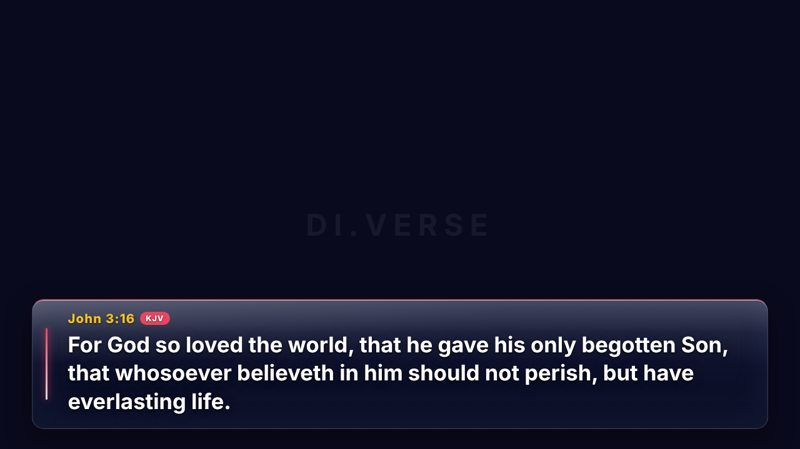
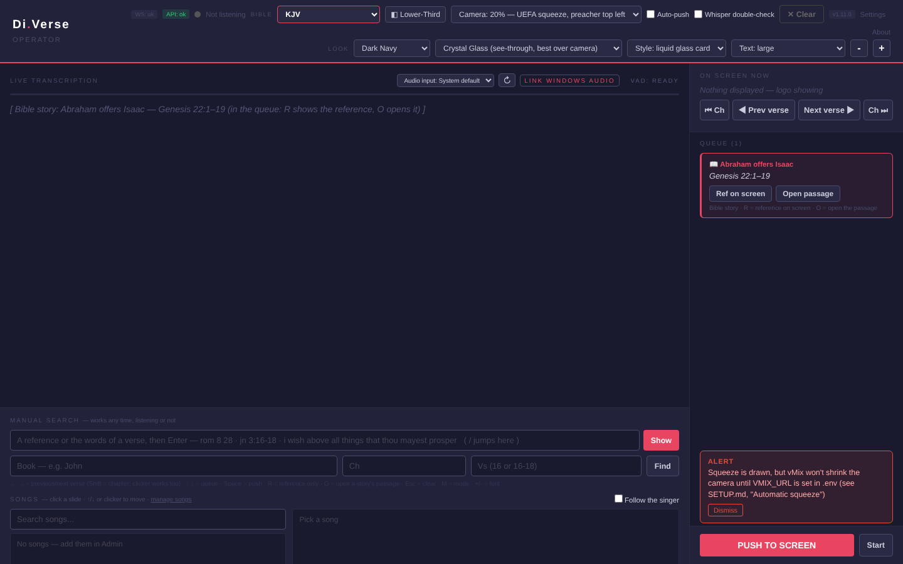
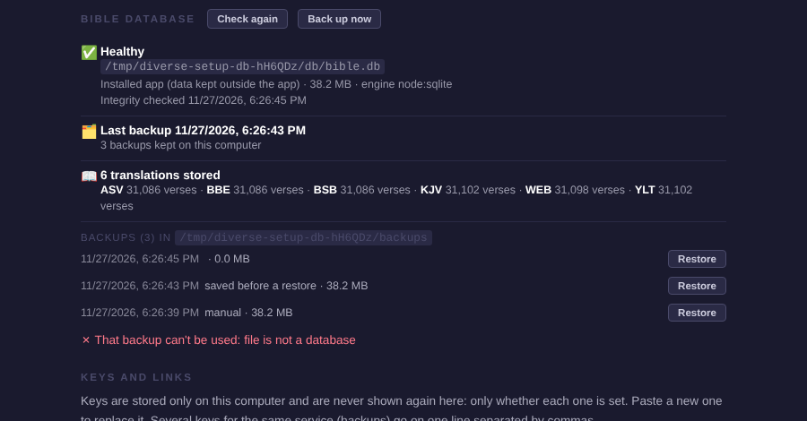

# Di.Verse v1.11.1: final acceptance evidence

Release candidate branch `feature/v1.11.1-integration-20261127`, PR [#21](https://github.com/AndreOmniBarry/Di.Verse/pull/21) (draft, not merged), against rewritten `main` `3f8ab4a`.
Prepared 27 November 2026.

Every number here was copied from real output. **Simulated speech** (text fed to the real detection route and Operator page) is never counted as a microphone test. Checks that need the owner and the church computers are marked **Not tested (owner)** until their results are filled in from `VOICE_AND_HARDWARE_TEST_PLAN.md`.

No owner database was used. All automated tests ran on disposable databases (public-domain seed editions, or synthetic wording). The owner's 57+ edition library stays on the Mac.

## 1. Acceptance summary

| # | Area | Status | Evidence |
|---|---|---|---|
| 1 | Automated test suite (`npm test`) | **Passed** | §3: 179 tests, 176 passed, 0 failed, 3 skipped (reasons given) |
| 2 | Database health, backup, restore, rollback, both SQLite engines | **Passed** | §8: 26/26 on the two engines, plus 6/6 persistence, 20/20 Setup browser checks, 360 MB timing |
| 3 | Partial Bible import (PR #16) | **Passed** (automated) | §7: in `npm test` and CI |
| 4 | Partial translation navigation (PR #17) | **Passed** (automated) | §7 |
| 5 | Footnote superscripts (PR #19) | **Passed** (automated) | §7, regression browser check |
| 6 | Licensed-text integrity (issue #18) | **Passed** (automated) | §7: synthetic fixtures; AI-only rows never offered as installed text (also a library-wide catalogue check) |
| 7 | Speech pipeline with text input (detection, cues, split phrases, reading lock, stale-result guard, translation switching) | **Passed** (simulated speech) | §4 |
| 8 | Full 57+ edition catalogue on the real library | **Not tested (owner)** | Kit ready and rehearsed (§5); one command on the Mac |
| 9 | Per-edition voice switching | **Not tested (owner)** | List generated by the kit (§5, §6) |
| 10 | Real microphone, Whisper/Groq, captions | **Not tested (owner)** | Plan §C |
| 11 | Windows PC 2 → Mac Focusrite/mixer audio link | **Not tested (owner)** | Plan §B; link security covered by server tests |
| 12 | vMix output, preacher monitor on real screens | **Not tested (owner)** | Plan §A4–A5, E3; browser rendering passed (§4) |
| 13 | Projection, lyrics, stories, reference-only, clicker, reconnection, no JS errors | **Passed** (browser) | §4: regression 17/17 |
| 14 | Mac and Windows packages built and verified | **Passed** | §9: local and CI |
| 15 | Native start on a real Mac and a real Windows PC | **Not tested (owner)** | Plan §A1–A2 |
| 16 | Repository history free of the AMP archive | **Partly complete** | Branches and tags are clean. Closed PR refs still reach it; GitHub Support request drafted (§11) |

## 2. What is in v1.11.1, and the disposition of each PR and issue

| Item | Disposition |
|---|---|
| PR #20, database health / backup / restore | Base of the release branch, plus one fix found in QA: opening Setup no longer runs a blocking full integrity check (§8). PR #20 is superseded by #21 and can be closed after #21 is accepted. |
| PR #16, partial archive import | Merged into the release branch unchanged (it was based on current `main`) |
| PR #17, partial navigation | Merged unchanged |
| PR #19, footnote superscripts | Merged unchanged |
| PR #12, sermon speech, Windows audio link, licensed-text guard | Reconciled as one reviewed squash (`5ade4ee`), not its 61 commits. Its footnote, navigation and import parts are superseded by #19, #17 and #16. `main`'s catalogue Whisper prompt is kept, with #12's sermon hints added. Its separate `test.yml` workflow is left out (the release workflow already tests every PR). |
| Issue #18, AI wording under licensed names | Implemented by #12's guard; verified (§7) |
| Earlier listening work (reading lock, second listen, split references, stories, reference-only, modern wording, self-refreshing translation list, spoken switch re-shows the verse) | Replayed onto the release branch and reconciled with the v1.11.0 parser |
| Fixes made during integration | The parser hears "go back to / switch back to the King James"; a split reference (book, then numbers) auto-pushes; Setup health no longer blocks; the release workflow's hard-coded 1.11.0 file names would have failed the installer job after the version bump, and were corrected |

**Behaviour changes for the owner to confirm** (from PR #12):
1. Auto-push is off by default.
2. Auto-push needs confidence ≥ 0.93, so exact quotes (0.92) and completed half-heard references (0.90) wait in the queue.

## 3. Automated test totals

| Run | Where | Tests | Passed | Failed | Skipped |
|---|---|---|---|---|---|
| `npm test` on `d6e0e8d` | cloud workspace, Node 22.23.5 | 179 | 176 | 0 | 3 |
| CI run [#47](https://github.com/AndreOmniBarry/Di.Verse/actions/runs/46048860073) on `0292b3c` | GitHub Actions | see §10 | | 0 | |
| CI on the final head | GitHub Actions | see §10 | | | |

**The 3 skips, all expected:**
- the full-catalogue test and the older spoken-catalogue gate, which need the owner's library;
- the modern-wording finder test, which needs BSB. The test runner's throwaway copy keeps only the four seed editions. Run separately on a copy with BSB, it passes 4/4.

**Run separately** (not part of `npm test`):

| Check | Result |
|---|---|
| Backup/restore, node:sqlite | 13/13 |
| Backup/restore, better-sqlite3 | 13/13 |
| Persistence and HTTP 403 | 6/6 |
| Browser: screen guard | holds |
| Browser: listening | holds |
| Browser: translations | 30/30 |
| Browser: Setup database | 20/20 |
| Browser: product regression | 17/17 |
| Catalogue kit rehearsal: seed library (6 editions) | passed, lifecycle 5/5 |
| Catalogue kit rehearsal: synthetic library (partial edition, paragraph range, stale AI rows) | passed, lifecycle 5/5 |
| Catalogue kit negative control (wrong recorded count) | fails as it should |

## 4. Speech, projection and operator behaviour (automated, simulated speech)

- **Detection with text input:** the parser and detection tests in `npm test`. They cover references in many spoken forms, number words and run-together numbers, several references in one sentence, voice cues, misheard non-existent verses (closest verses offered), Nigerian-English Whisper variants of book names with false-positive guards, translation switching by code or name, and translation plus reference.
- **Operator page in Chromium:**
  - `screen-guard.js`: an older result never replaces a newer screen; exact quotes wait in the queue; auto-push is off by default.
  - `listening.js`: the reading lock, following the reading into the next verse, a book then its numbers, a second listen for garbled numbers.
  - `translations.js`: an open page picks up imports and removals; a spoken switch re-shows the verse with its range; unavailable editions are refused honestly; the newest overlapping request wins.
- **Product regression** (`regression.js`):
  - lower-third, squeeze and full-screen;
  - a range with verse numbers;
  - the preacher monitor in step;
  - footnote superscripts on scripture but never on lyrics;
  - a Bible story suggestion and its reference-only lower third;
  - duplicate detection;
  - clicker PageDown/PageUp;
  - Reconnecting, then recovery after a server restart;
  - no JavaScript errors on Operator, projection, preacher, Setup, Admin and Admin → Bibles.

Screenshots (KJV or synthetic text only):

| | |
|---|---|
|  |  |
|  |  |
|  |  |

Also in `screenshots/`: `projection-lyrics.png`, `preacher-monitor.png`, `operator.png`.

## 5. Full 57+ edition catalogue: kit ready, owner run pending

`scripts/qa-full-catalogue.js` makes a **read-only consistent copy** of the library you point it at, and runs `test/full-catalogue-qa.test.js` on that copy only.

**Checks for every installed edition:**
1. code and name;
2. stored rows, verses covered and books, against what was recorded;
3. no availability from AI cache rows, also checked library-wide;
4. switching by code;
5. switching by unique name or alias, in the parser and in the running detection route;
6. a spoken reference plus the edition, through the detection route;
7. the stored text is returned;
8. no fallback to another edition;
9. the code is in the Whisper prompt;
10. a verse inside a paragraph range is served from that paragraph, and a book the edition lacks is never labelled as that edition.

Plus import → remove → restore updating the catalogue, spoken recognition and Whisper prompt.

**Outputs** (no verse text, only references and 8-character fingerprints):
- `qa-output/translation-manifest.md` and `.json`: code, name, coverage, rows, verses, ranges, AI rows, sample reference and the ten checks per edition;
- `qa-output/voice-test-list.csv`: what to say for each edition.

**Results on the owner's library: _to be filled in from `qa-output/translation-manifest.md`_ (editions checked: __, failures: __).**

## 6. Per-edition voice recognition

**Not tested (owner).** Use `qa-output/voice-test-list.csv` (plan §D8). Results: editions heard correctly __ / __; projected correctly __ / __; failures and what was transcribed: __.

## 7. Import, partial navigation and licensed-text integrity (automated)

- **Import (PR #16):** `test/archive-importer.test.js` and `test/library.test.js`. Covers JSON and ZIP chapter archives, partial editions without all 66 books, book and testament recognition, archives without testament folders, MSG and J. B. Phillips paragraph ranges kept as single passages, unsafe and invalid paths rejected, and the source and permission statement required (`authorized`).
- **Navigation (PR #17):** `test/navigation.test.js` and the server tests. Next and Previous use the stored passage boundaries across chapters and books, respect gaps and ranges, and keep the requested edition when a KJV fallback is shown.
- **Footnotes (PR #19):** `test/scripture-text.test.js` plus the regression browser check. Display only; stored text unchanged; unsupported markers left as written; lyrics untouched.
- **Licensed text (issue #18):** `test/aiVerse.test.js`. TPT is never fabricated from agreeing AI providers. It isn't listed when only AI keys exist, and stale AI-cached wording never counts as installed text. An authorised partial import works; API.Bible fills its missing passages; an empty catalogue record doesn't block API.Bible; unlicensed experimental editions only use the clearly marked AI beta path. Fixtures are synthetic ("a deliberately fictional test-edition sentence").

## 8. Backup and restore

Details are in `DB_BACKUP_RESTORE_EVIDENCE.md`. Both engines pass all 13 scenario checks:
- WAL-aware backup;
- unique names;
- metadata and listing without paths;
- confirmation required;
- missing, damaged and non-Bible files refused;
- safety backup;
- lookups and the catalogue parser after a restore;
- rollback when the restored file fails;
- "last backup" ignores stray files;
- the plain health report runs no slow check.

**Large-library timing** on a disposable 360 MiB library (1,741,660 rows of public-domain text; the owner's is 342 MB), Linux with 4 cores:

| | node:sqlite | better-sqlite3 |
|---|---|---|
| Back up (copy and integrity check of the copy) | 3.0 s | 2.7 s |
| Restore (validate, safety backup, swap, reopen, integrity) | 7.3 s | 7.0 s |
| Full integrity check (Check again) | 2.3 s | 2.0 s |
| Health report on opening Setup (after the fix) | 0.36 s | |

These operations run synchronously, so Di.Verse pauses while they work. Back up and restore outside live services. **Check again** carries a tooltip saying so.

**Backups never ship:**
- they are stored in `<data folder>/backups`;
- `backups/` is in `.gitignore`;
- neither package contains a `backups` folder (§9).

## 9. Mac and Windows packages

**Local** `npm run build:apps` on `d6e0e8d`: exit code 0. Starter editions: ASV, BBE, BSB, KJV, WEB, YLT.

| Package | Bytes | SHA-256 | Zip test |
|---|---|---|---|
| `Di.Verse-1.11.1-mac.zip` | 94,517,422 | `12bdd2d1668f01ae93dddec9664efc2c8c3900b36c189addff34f410c191034d` | no errors |
| `Di.Verse-1.11.1-windows.zip` | 52,032,528 | `47aef6e58d3f14ca3ce60b189b53ee37d362a59ed7b057aa0aa843f271b8e13e` | no errors |

**Contents (both packages):**
- version 1.11.1;
- contain `dbBackup.js`, `routes/database.js`, `views/audio-bridge.html`, `scripture-text.js`, `archiveImporter.js`, `stories.js`, `reading.js`, the audio worklet and `LICENSE`;
- contain no `backups/`, `bible-imports`, AMP file, `.env` or Di.Verse test files.

**Packaged-mode smoke test** (the Windows package's app code run with the workspace's Linux Node; this is not a native Windows start):
- `/api/version` returned 1.11.1;
- health reported packaged mode, integrity ok and the 6 starter editions;
- `/audio-bridge` without its token returned HTTP 403;
- John 3:16 came back in BSB without fallback.

**CI** (macOS 15 runner): see §10. **Native start** on a real Mac and Windows PC: Not tested (owner), plan §A1–A2.

## 10. CI workflow runs

| Run | Head | Result |
|---|---|---|
| [#45](https://github.com/AndreOmniBarry/Di.Verse/actions/runs/46046212598) (PR #20) | `9191e36` | success: tests 127 passed / 2 skipped; Mac and Windows installers built and verified |
| [#46](https://github.com/AndreOmniBarry/Di.Verse/actions/runs/46046830651) (PR #20, evidence only) | `710f10a` | success |
| [#47](https://github.com/AndreOmniBarry/Di.Verse/actions/runs/46048860073) (PR #21) | `0292b3c` | success |
| PR #21 final head | `d6e0e8d` or later | FINAL_CI |

CI installs without optional dependencies, so the better-sqlite3 test file reports itself skipped there. Both engines are covered locally (§3).

## 11. Remaining limitations

1. **Owner checks pending:** the full-catalogue run, per-edition voice, live microphone and Whisper, the Windows audio link, vMix, and native start. Rows 8–12 and 15 in §1 stay "Not tested" until done.
2. **Behaviour change to confirm:** whether queue-first (auto-push off, quotes queued) is the intended default for services.
3. **Backup and restore pause Di.Verse** for seconds on a large library (§8). There is no automatic clean-up of old backups. Another program writing `bible.db` during a restore isn't protected against.
4. **Phrase-finder search index:** built from KJV and BSB/WEB wording, rebuilt only when Di.Verse restarts.
5. **The Mac app is unsigned,** so it needs approval on first launch.
6. **Repository history:** the AMP archive is gone from every branch and tag, but closed PR refs (#4–#11, #13–#15) and the not-yet-rebuilt merge ref of open PR #12 still reach it. A GitHub Support request is drafted. The purge is not globally complete until GitHub confirms and a fresh mirror no longer contains blob `eb5121d1`.
